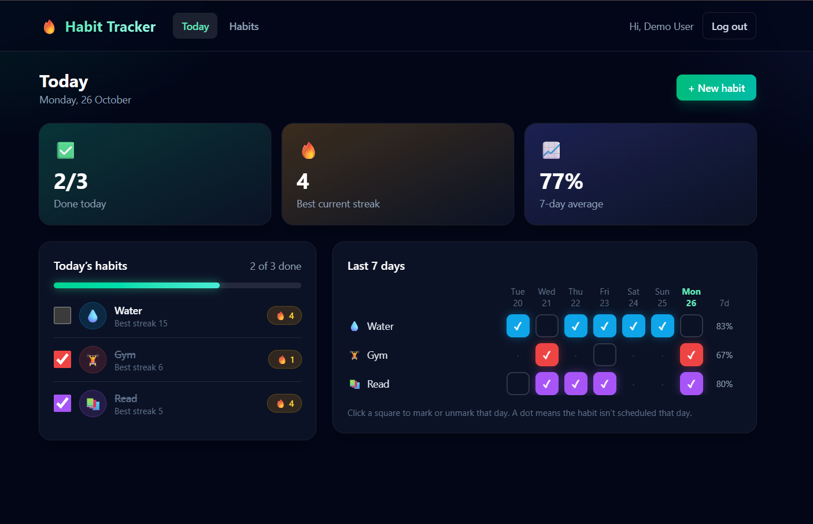
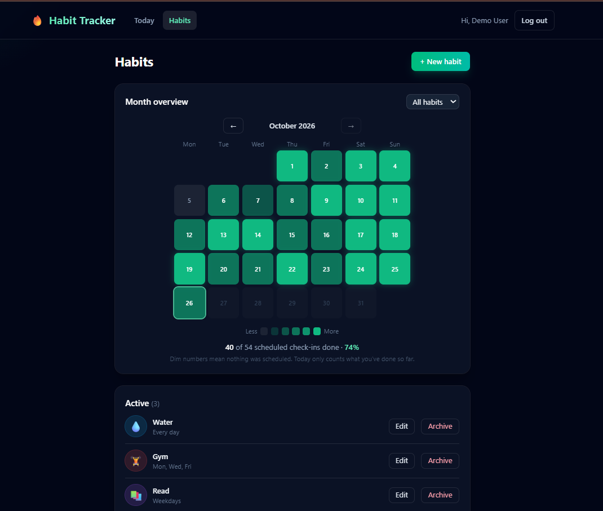

# 🔥 Habit Tracker

A full-stack MERN app for building daily habits. Each user gets a private account, a daily checklist, a 7-day grid, a month heatmap, and streaks and completion rates calculated on the server.

**Live demo:** [https://habit-tracker-tanu-sharma.vercel.app](https://habit-tracker-tanu-sharma.vercel.app) · **API:** [https://habit-tracker-api-4dtf.onrender.com](https://habit-tracker-api-4dtf.onrender.com)

**Demo login:** `demo1793018401728@test.com` / `secret123`

> The API runs on a free Render instance that sleeps after 15 minutes of inactivity. The first request after a pause can take up to a minute.




## Features

- Register and log in with JWT authentication and bcrypt-hashed passwords
- Create, edit and archive habits with an emoji, a color and the weekdays they apply to
- Tick habits off for today, or for any of the last 7 days, and undo them
- **Current streak, longest streak** and **7- and 30-day completion rates**, calculated by the API
- A month heatmap for all habits or a single habit, with navigation back through the last 12 months
- Archiving keeps history, and archived habits can be restored
- Every user can only read and change their own data
- Validation on the server for every rule (no future dates, only scheduled weekdays, no check-ins on archived habits)
- Dark, responsive interface built with Tailwind CSS

## Tech stack

| Layer    | Technology                                              |
| -------- | ------------------------------------------------------- |
| Frontend | React (Vite), React Router, Tailwind CSS                |
| Backend  | Node.js, Express                                        |
| Database | MongoDB Atlas, Mongoose                                 |
| Auth     | JSON Web Tokens, bcryptjs                               |
| Security | helmet, express-rate-limit, restricted CORS             |
| Hosting  | Vercel (client), Render (API), MongoDB Atlas (database) |

## How streaks work

The rules are implemented in one pure function (`server/utils/streaks.js`) that is tested with fixed dates.

- A streak is a run of **consecutive scheduled days** that were completed.
- **Days off are neutral.** A habit scheduled Monday, Wednesday and Friday keeps its streak through Tuesday.
- A **missed scheduled day** ends the streak.
- **Today is still open.** An unchecked today doesn't break the streak and isn't counted in the completion rates. Once it's checked, it counts.
- **Completion rate** is completed days divided by scheduled days within the window, counting only days since the habit started being tracked. It is `null` when there is nothing to measure yet, which is different from 0%.
- Tracking starts on the day the habit was created, or on its earliest check-in if that is earlier.
- Streaks are **calculated on request** from the check-ins, so there is no stored counter that can drift out of sync when a day is unchecked or a schedule changes.

## Project structure

```
habit-tracker/
├── client/                      React app
│   ├── vercel.json              Rewrites all paths to the single-page app
│   └── src/
│       ├── components/          Layout, TodayList, WeekGrid, StatCards, MonthHeatmap, HabitForm
│       ├── pages/               AuthPage (login/register), Dashboard, Habits
│       ├── api.js               All HTTP calls to the API
│       ├── AuthContext.jsx      Logged-in user and token storage
│       ├── useToday.js          The user's local date, kept current past midnight
│       └── utils.js, constants.js
└── server/                      Express API
    ├── config/                  Database connection
    ├── controllers/             auth, habit, checkin and stats logic
    ├── middleware/              JWT verification (protect)
    ├── models/                  User, Habit, CheckIn
    ├── routes/                  Route definitions
    ├── utils/                   dates.js (date helpers), streaks.js (streak and rate logic)
    ├── test-*.js                Test scripts (see Testing)
    └── server.js                App setup, CORS, rate limiting
```

## API reference

Base URL: `https://habit-tracker-api-4dtf.onrender.com/api`

Protected routes need the header `Authorization: Bearer <token>`. Errors have the shape `{ "message": "..." }`.

### Auth

| Method | Endpoint         | Auth | Description                           |
| ------ | ---------------- | ---- | ------------------------------------- |
| POST   | `/auth/register` | No   | Create an account and receive a token |
| POST   | `/auth/login`    | No   | Log in and receive a token            |
| GET    | `/auth/me`       | Yes  | The logged-in user                    |

```json
{ "name": "Test User", "email": "test@example.com", "password": "secret123" }
```

Response for register and login:

```json
{
  "_id": "6540...",
  "name": "Test User",
  "email": "test@example.com",
  "token": "eyJhbGciOi..."
}
```

### Habits

| Method | Endpoint              | Auth | Description                                                        |
| ------ | --------------------- | ---- | ------------------------------------------------------------------ |
| GET    | `/habits`             | Yes  | List active habits (add `?includeArchived=true` for all)           |
| POST   | `/habits`             | Yes  | Create a habit                                                     |
| PUT    | `/habits/:id`         | Yes  | Update `name`, `emoji`, `color` or `days` (send only what changes) |
| PATCH  | `/habits/:id/archive` | Yes  | Archive a habit (repeating is harmless)                            |
| PATCH  | `/habits/:id/restore` | Yes  | Restore an archived habit                                          |

```json
{ "name": "Gym", "emoji": "🏋️", "color": "#ef4444", "days": [1, 3, 5] }
```

Days use JavaScript's numbering: `0` is Sunday and `6` is Saturday. Only `name` is required.

### Check-ins

| Method | Endpoint                        | Auth | Description                                                               |
| ------ | ------------------------------- | ---- | ------------------------------------------------------------------------- |
| PUT    | `/habits/:id/checkins/:date`    | Yes  | Mark a habit done on a date. `201` when created, `200` if it already was. |
| DELETE | `/habits/:id/checkins/:date`    | Yes  | Undo a check-in. Always `200`, even if there was none.                    |
| GET    | `/checkins?startDate=&endDate=` | Yes  | Check-ins in a date range, optionally filtered with `&habitId=`           |

Dates are plain `YYYY-MM-DD` strings in the user's own calendar. Response of `PUT`:

```json
{ "_id": "6541...", "habit": "6540...", "date": "2026-10-26", "checked": true }
```

Response of `GET /checkins`:

```json
[{ "_id": "6541...", "habit": "6540...", "date": "2026-10-26" }]
```

### Stats

| Method | Endpoint                  | Auth | Description                                         |
| ------ | ------------------------- | ---- | --------------------------------------------------- |
| GET    | `/stats?today=YYYY-MM-DD` | Yes  | Streaks and completion rates for every active habit |

The client sends its own local date as `today`, because only the browser knows the user's time zone.

```json
{
  "today": "2026-10-26",
  "habits": [
    {
      "_id": "6540...",
      "name": "Water",
      "emoji": "💧",
      "color": "#0ea5e9",
      "days": [0, 1, 2, 3, 4, 5, 6],
      "startDate": "2026-10-22",
      "scheduledToday": true,
      "checkedToday": false,
      "currentStreak": 4,
      "longestStreak": 4,
      "last7": { "scheduled": 4, "completed": 4, "rate": 100 },
      "last30": { "scheduled": 4, "completed": 4, "rate": 100 }
    }
  ]
}
```

### Other

| Method | Endpoint  | Description                   |
| ------ | --------- | ----------------------------- |
| GET    | `/health` | Health check (outside `/api`) |

### Validation rules

- **Habit:** `name` is required (at most 50 characters). `emoji` defaults to ✅. `color` is a hex code like `#6366f1` (default `#6366f1`). `days` is a non-empty list of numbers from 0 to 6 (default every day, de-duplicated and sorted). At most 50 active habits per user.
- **Check-in:** the date must be a real `YYYY-MM-DD` date, not in the future, at most 365 days back, and a weekday the habit is scheduled on. Archived habits can't be changed.
- **Check-in list:** `startDate` and `endDate` are required, and the range can be at most 366 days.
- **Stats:** `today` must be a date that could be "today" somewhere on Earth right now.

**Status codes:** `200` OK, `201` created, `400` validation error, `401` missing or invalid token, `404` not found (including other users' data), `409` email already registered.

## Getting started locally

**Prerequisites:** Node.js 18 or newer and a free [MongoDB Atlas](https://www.mongodb.com/atlas) cluster.

```bash
git clone https://github.com/TanuSharma2004/habit-tracker.git
cd habit-tracker
```

**1. API**

```bash
cd server
npm install
cp .env.example .env      # on Windows: copy .env.example .env
# edit .env and fill in your values
npm run dev
```

**2. Client** (in a second terminal)

```bash
cd client
npm install
npm run dev
```

Open `http://localhost:5173`.

### Environment variables

**`server/.env`**

| Variable         | Description                                                              |
| ---------------- | ------------------------------------------------------------------------ |
| `PORT`           | Port for the API (default 5000; Render sets its own)                     |
| `MONGO_URI`      | MongoDB Atlas connection string, including the database name             |
| `JWT_SECRET`     | Long random string used to sign tokens                                   |
| `JWT_EXPIRES_IN` | Token lifetime, for example `7d`                                         |
| `CLIENT_URL`     | Allowed frontend origin(s) for CORS, comma-separated                     |
| `USE_PUBLIC_DNS` | Optional. Set to `true` if `mongodb+srv://` lookups fail on your network |

**`client/.env`**

| Variable       | Description                                                  |
| -------------- | ------------------------------------------------------------ |
| `VITE_API_URL` | Base URL of the API, for example `http://localhost:5000/api` |

## Testing

Scripts in `server/` exercise the code. Run the API first for all except the streak tests.

```bash
node test-streaks.js       # streak and completion rules with fixed dates (no server needed)
node test-habits.js        # habit CRUD, archive/restore, validation, ownership, 50-habit limit
node test-checkins.js      # check/uncheck, schedule and date rules, five simultaneous requests
node test-stats.js         # the stats endpoint end to end
node seed-habit-demo.js    # creates a demo user with about 45 days of history
```

Set `API_URL` to run the API scripts against another server. They create test users, so run them against a local database.

## Design decisions

- **Dates are plain strings.** Check-ins are stored as `YYYY-MM-DD` in the user's own calendar, and the browser sends its local date. No time or time zone is attached, so a check-in can never slip to another day.
- **The database enforces "once per day".** A unique index on habit and date means two requests arriving at the same moment still create one record. Checking is safe to repeat, and unchecking always succeeds.
- **Archive, don't delete.** Check-ins reference habits, so archiving keeps history and streaks intact and allows restoring.
- **Ownership on every query.** Each record stores its owner and every lookup filters by the logged-in user's id. Other users' records return `404`, not `403`, so the API doesn't reveal which ids exist.
- **Two queries for all stats.** The stats endpoint loads the habits once and all their check-ins in one query, then calculates in memory, instead of querying per habit.
- **Server-side rules.** The interface hides invalid choices for convenience, but the API enforces every rule, so direct calls can't bypass them.
- **Whitelisted fields.** Only expected fields are read from request bodies, so a client can't set the owner or the archive date.
- **Hardened for production.** CORS is limited to the configured frontend, login and register are rate limited, security headers come from helmet, and the server refuses to start without its required secrets.

## Known limitations and next steps

- The JWT is stored in `localStorage`. An `httpOnly` cookie would reduce exposure to XSS.
- The server can't know a user's time zone, so the start date of a habit is approximated from its creation time.
- No reminders or notifications yet.
- The tests are scripts. A proper test runner with CI is a next step.
- Possible features: weekly targets ("3 times a week"), notes on check-ins, CSV export.

## Author

**Tanu Sharma** · [GitHub](https://github.com/TanuSharma2004) · [LinkedIn](https://www.linkedin.com/in/tanu-sharma-885862324)
